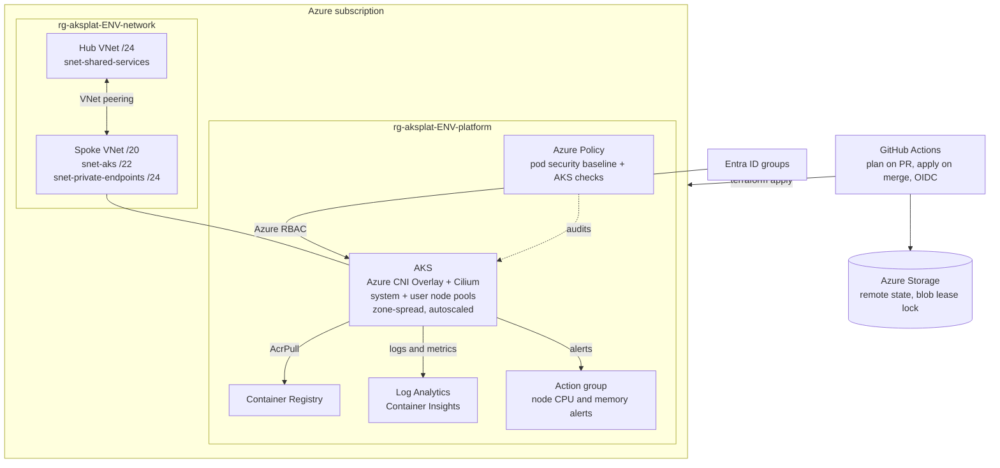

# Azure AKS Terraform Platform

[](https://github.com/YOUR_GITHUB_USERNAME/azure-aks-terraform-platform/actions/workflows/terraform.yml)


Production-style Azure Kubernetes platform defined entirely in Terraform: a hub-and-spoke network, a hardened
AKS cluster, a container registry, monitoring, Azure Policy guardrails and Entra ID RBAC. It deploys to
**dev, staging and prod** from one codebase, with remote state, a plan-on-PR / apply-on-merge pipeline using
GitHub OIDC (no stored secrets), and nightly drift detection.

> Personal portfolio project. It is built from public documentation and generic patterns and is not derived from
> any employer's or client's code or configuration.

## Architecture



## What it demonstrates

| Area | Where to look |
|---|---|
| Landing-zone style networking (hub-and-spoke, peering, per-subnet NSGs) | [`modules/network`](modules/network) |
| AKS hardening: Entra ID + Azure RBAC, workload identity, Cilium network policy, Azure Policy add-on, zone spread, autoscaling, planned maintenance window | [`modules/aks`](modules/aks) |
| Governance as code: built-in Azure Policy assignments, group-based RBAC, optional delete lock | [`modules/governance`](modules/governance) |
| Observability baseline: Log Analytics, Container Insights, control-plane diagnostics, metric alerts | [`modules/monitoring`](modules/monitoring), [`modules/aks`](modules/aks) |
| Reusable, versioned modules with validated inputs and preconditions | [`modules/`](modules) |
| Remote state in Azure Storage (Entra auth, versioning, soft delete, blob-lease locking), one state per environment | [`scripts/bootstrap-state.sh`](scripts/bootstrap-state.sh), [`backends/`](backends) |
| Environment-based deployments (dev, staging, prod) | [`envs/`](envs) |
| CI/CD as code: fmt, validate, TFLint, Trivy, PR plan comments, gated promotion, GitHub OIDC | [`.github/workflows`](.github/workflows), [`docs/cicd-setup.md`](docs/cicd-setup.md) |
| Drift detection | [`.github/workflows/drift.yml`](.github/workflows/drift.yml) |

## Repository layout

```text
.
├── main.tf / variables.tf / outputs.tf   # root module: wires the modules together
├── versions.tf / providers.tf            # provider pins, azurerm backend (partial config)
├── envs/                                 # dev.tfvars, staging.tfvars, prod.tfvars
├── backends/backend.hcl.example          # remote state settings (real file is generated, git-ignored)
├── modules/
│   ├── network/                          # hub + spoke VNets, subnets, NSGs, peering
│   ├── aks/                              # cluster, node pools, identity, diagnostics, alerts
│   ├── acr/                              # container registry
│   ├── monitoring/                       # Log Analytics, Container Insights, action group
│   └── governance/                       # Azure Policy, Entra group RBAC, optional lock
├── scripts/bootstrap-state.sh            # creates the remote-state storage account
├── .github/workflows/                    # terraform.yml, apply.yml, drift.yml
├── docs/cicd-setup.md                    # OIDC and GitHub setup walkthrough
└── Makefile                              # make plan ENV=dev, make apply ENV=dev, ...
```

## Environments

| | dev | staging | prod |
|---|---|---|---|
| AKS tier | Free | Free | Standard (SLA) |
| Availability zones | none | 1, 2, 3 | 1, 2, 3 |
| Node pools | system only (runs workloads) | system + user | system + user |
| Autoscale range (per pool) | 1 to 2 | 1 to 3 | 3 to 5 system, 3 to 10 user |
| Registry | Basic | Standard | Premium |
| Log retention | 30 days | 30 days | 90 days |
| Alerts | off | on | on |
| Local kubeconfig admin | enabled | enabled | **disabled** (Entra only) |
| Delete lock | off | off | on |
| Address space (hub / spoke) | 10.10.0.0/24, 10.10.16.0/20 | 10.20.0.0/24, 10.20.16.0/20 | 10.30.0.0/24, 10.30.16.0/20 |

Each environment has its own state file (`aks-platform/<env>.tfstate`) in the same storage account. Environments
are separated by tfvars files rather than Terraform workspaces so that each one can differ in shape and so a
change to prod is always an explicit, reviewable diff.

## Prerequisites

* An Azure subscription where you can create resources and role assignments (Owner, or Contributor plus
  User Access Administrator)
* [Azure CLI](https://learn.microsoft.com/cli/azure/install-azure-cli), [Terraform](https://developer.hashicorp.com/terraform/install) 1.9 or newer, and `make`
* Optional: [TFLint](https://github.com/terraform-linters/tflint), [GitHub CLI](https://cli.github.com/)
* Enough vCPU quota in the target region (dev needs 2 to 4 vCPUs of `Standard_D2s_v5`)

## Quick start (dev)

```bash
az login
export ARM_SUBSCRIPTION_ID="$(az account show --query id -o tsv)"

make bootstrap            # one-time: creates the remote-state storage account
make plan ENV=dev         # init + plan
make apply ENV=dev        # apply the saved plan
```

Connect to the cluster:

```bash
make credentials ENV=dev ADMIN=1   # dev keeps the local admin account for quick access
kubectl get nodes
```

For staging and prod the local admin account is off, so access goes through Entra ID. Put your group's object ID in
`aks_admin_group_object_ids` (or `aks_reader_group_object_ids`) in the tfvars file, apply, then run
`make credentials ENV=staging` and `kubectl get nodes` (you will be prompted to sign in). To grant yourself access
in dev without a group:

```bash
az role assignment create \
  --assignee "$(az ad signed-in-user show --query id -o tsv)" \
  --role "Azure Kubernetes Service RBAC Cluster Admin" \
  --scope "$(terraform output -raw aks_cluster_id)"
```

Clean up when you are finished (this stops the billing):

```bash
make destroy ENV=dev
```

> The prod plan intentionally fails until `aks_admin_group_object_ids` is set in `envs/prod.tfvars`. With the local
> admin account disabled, an empty admin list would leave nobody able to manage the cluster, so a precondition in
> the AKS module blocks it.

## Useful commands

```bash
make help        # list targets
make fmt         # terraform fmt -recursive
make validate    # init without a backend + terraform validate
make lint        # tflint
make plan ENV=staging
make output ENV=dev
```

## CI/CD

See [`docs/cicd-setup.md`](docs/cicd-setup.md) for the one-time Azure and GitHub setup.

* **Pull request:** formatting, validation, TFLint and a Trivy scan run first. Then a plan runs for every
  environment and is posted as a comment on the PR.
* **Merge to `main`:** applies dev, then staging, then prod. Add required reviewers to the GitHub Environments to
  gate staging and prod.
* **Nightly:** the drift workflow runs `terraform plan -detailed-exitcode` and fails if the real infrastructure no
  longer matches the code.

## Design decisions

* **Azure CNI Overlay + Cilium.** Pods get overlay IPs, so the AKS subnet only needs room for nodes, which avoids
  the classic Azure CNI IP exhaustion problem. Cilium provides network policy enforcement and an eBPF data plane.
* **Dedicated system and user pools (staging, prod).** The system pool is tainted for critical add-ons only, so
  application load cannot starve CoreDNS and friends.
* **Entra ID only in prod.** Local accounts are disabled; access is granted to groups through Azure RBAC roles,
  so joiners, movers and leavers are handled in the identity provider, not in kubeconfig files.
* **Managed identities everywhere.** A user-assigned identity for the control plane, the kubelet identity for
  `AcrPull`, workload identity (OIDC issuer) for pods, and no registry admin user.
* **Subnets derived from two CIDRs.** `cidrsubnet()` carves the hub and spoke ranges, so adding an environment is
  a new tfvars file and a new state key.
* **State security.** Shared-key access is disabled on the state account, access is via Entra RBAC, and blob
  versioning plus soft delete allow recovery from a bad write. Azure blob leases provide state locking.
* **Policies start in Audit.** The built-in Kubernetes initiatives default to Audit, so the assignment surfaces
  compliance gaps without breaking deployments. Set `policy_initiative_effect = "Deny"` per environment once the
  findings are clean.
* **Booleans for feature switches.** `enable_alerts`, `attach_acr` and friends are plain variables rather than
  checks on resource attributes, because Terraform cannot use values that are only known after apply in `count`.

## Troubleshooting

| Symptom | Likely cause and fix |
|---|---|
| `ARM_SUBSCRIPTION_ID is not set` | `export ARM_SUBSCRIPTION_ID="$(az account show --query id -o tsv)"` (azurerm 4.x requires it) |
| Policy lookup fails with "could not be found" | Microsoft renamed a built-in. Find the current name with `az policy definition list --query "[?contains(displayName,'Kubernetes')].displayName" -o tsv` and update `modules/governance/variables.tf` |
| `QuotaExceeded` / `SkuNotAvailable` | Pick another VM size or region in the tfvars file, or request a quota increase |
| `403` writing state | Your identity needs *Storage Blob Data Contributor* on the state account (the bootstrap script grants it to you) |
| `Error acquiring the state lock` | A previous run died. Verify nothing is running, then `terraform force-unlock <LOCK_ID>` |
| Destroy fails in prod | The resource lock is doing its job. Set `enable_resource_lock = false`, apply, then destroy |
| Cannot reach the API server | Check `api_server_authorized_ip_ranges` and `private_cluster_enabled` for that environment |

## Verify locally

```bash
make fmt
make validate
make lint
```

Commit the generated `.terraform.lock.hcl` so everyone (and CI) uses the same provider versions.

## Roadmap

* Azure Firewall in the hub with user-defined routes for controlled egress
* Private cluster with private endpoints for ACR and Key Vault
* Key Vault with the Secrets Store CSI driver
* Managed Prometheus and Managed Grafana
* ArgoCD bootstrap for GitOps (see the companion gitops-argocd-helm-kubernetes project)
* Subscription vending and management-group level policy

## License

MIT, see [LICENSE](LICENSE).
